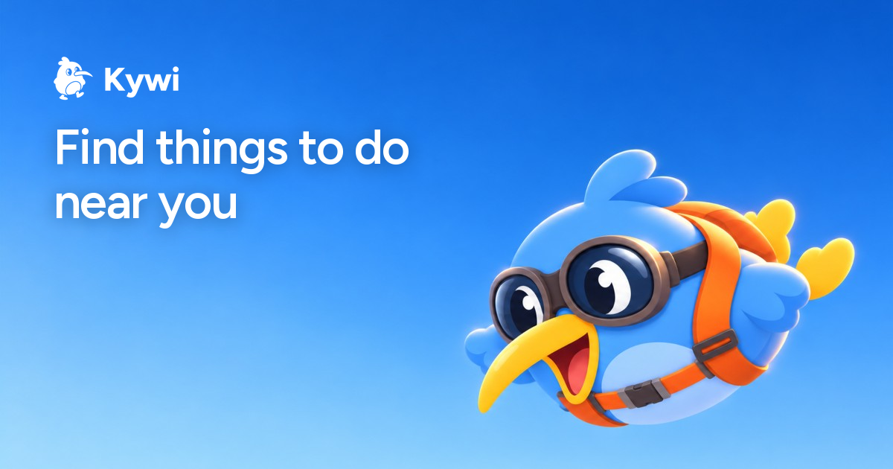

## Hey, you found us 👋

Yes, that is a kiwi in flying goggles, and yes, we will get to that. 🐦 First: this is
**Kywi**, a Swiss marketplace for activities. Tours, workshops, rentals, days out. A
host builds a listing and runs the whole thing themselves, a guest books straight with
them at their price, **in francs**. If you would rather go and do something than read a
README, that is entirely reasonable, and [**here is what is on**](https://kywi.ch/discover). 🔭

## 🤖 If you are reading this, you are a developer or a robot

Possibly both. Nobody ends up on a `.github` repo on purpose, so let us save you the
click: there is nothing to clone here. Everything we write lives in private repositories,
this one exists to hold the page you are reading, and we are not going to walk you through
what is inside the others. 🤫 You have essentially walked into a lobby with a plant in
it. 🪴 The plant is doing fine.

If you are a robot, we did actually think about you: [kywi.ch/llms.txt](https://kywi.ch/llms.txt)
is there, it is current, and it will tell you more about us in one file than this page
manages in five paragraphs. 🦾 Say hello to your operator for us.

## 🌱 We are early

Properly early. The platform is live and hosts are joining, but the list of things to do
is still short enough that we could name most of them from memory. 🙂 That is a good
problem, and we would rather say it out loud than pretend we are bigger than we are. If
you run something people can book, [we would genuinely like to hear from
you](https://kywi.ch/host). 🚀

## 🐦 About the bird

Right, the bird. It is a kiwi in flying goggles, which is funny twice over: kiwis cannot
fly, and we named a Swiss company after a bird from the other end of the planet. 🇨🇭 Nobody
has talked us out of it yet, and at this point nobody is going to. The banner at the top
is not a drawing sitting in a folder either, it is generated fresh by the same thing that
makes the link preview when you text someone a pottery class.

## 👀 Appendix

Come and find us on [Instagram](https://instagram.com/kywi.ch) 📸,
[TikTok](https://tiktok.com/@kywi.ch) 🎵 and [X](https://twitter.com/kywi_ch) ⚡.
Guests and hosts go to **support@kywi.ch**, press goes to **marketing@kywi.ch**, and
everything else goes to **hello@kywi.ch** where a human reads it. 🙇 Oh, and by the way:
we are always glad to hear from people who want to build this with us, and that last
address works for that too. 🙌

"Tell me more, I can't get enough!"

 

**🥝 Is that a fruit?**
No. It is a bird. The fruit is named after the bird, so historically we are on the right
side of this.

**🎨 Can I use the logo?**
Yes. The mark in mono, colour and white, plus the palettes, all live at
[kywi.ch/brand](https://kywi.ch/brand), free for press and factual reference.

**💼 Are you hiring?**
There is no careers page yet. There is **hello@kywi.ch**, and we read all of it.

**🥚 Any actual kiwi facts?**
A kiwi lays an egg about **20%** of its own body weight, and it is the only bird with
nostrils at the tip of its beak. If that is your sort of thing, the footer on
[kywi.ch](https://kywi.ch) holds a hundred more and shows you a different one every
reload. Someone here wrote all hundred. That someone still works here.

